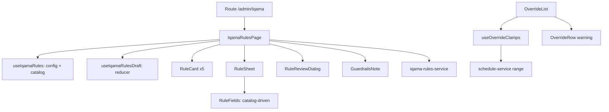

# Design Document — Iqama Rules Admin Tab

## Overview

A new admin page, `IqamaRulesPage` at `/admin/iqama`, modelled on the Adhan tab: card per prayer, bottom sheet to edit, draft reducer, sticky unsaved bar, review dialog, preview before save. It talks to the engine's `/api/v1/admin/iqama-rules` API.

## API contract (engine)

| Call | Use |
|---|---|
| `GET /` | `mode`, `currentRevision`, `versions`, `effective` (RuleSet or null), `today`, `defaultEffectiveFrom` (next Friday) |
| `GET /catalog` | prayers (`weeklyLockAllowed`, `fridayStartRequired`, `sunriseLimitAllowed`), base types with fields, modifier ranges, `guardrails` |
| `POST /preview` | body `{ settings: JSON string, effectiveFrom }` → `previewId`, 14 sample `days` (current vs proposed, with `clamped`), 365-day `summary` |
| `PUT /base` | body `{ settings, effectiveFrom, previewId, expectedRevision }`; 409 stale, 422 bad token, 400 non-Friday start |

Daily schedule entries may carry `iqama_clamped`.

## Components

| File | Role |
|---|---|
| `src/pages/IqamaRulesPage.tsx` | State, preview-on-review effect, save and error handling |
| `src/components/iqama-rules/RuleCard.tsx` | Prayer card with sentence and "Edited" badge |
| `src/components/iqama-rules/RuleSheet.tsx` | Rule type, modifiers, live 7-day strip |
| `src/components/iqama-rules/RuleFields.tsx` | Renders catalog fields (`int`, `time`, `list`, `oneOf`) |
| `src/components/iqama-rules/RuleReviewDialog.tsx` | Date, Friday check, year scan, confirm |
| `src/components/iqama-rules/GuardrailsNote.tsx` | Read-only "Always applied" numbered list from `catalog.guardrails` and `catalog.prayers` |
| `src/hooks/useIqamaRules.ts` | Loads config and catalog |
| `src/hooks/useIqamaRulesDraft.ts` | `SET_RULE` (drops a rule equal to the saved one), `SET_EFFECTIVE_FROM`, `RESET` |
| `src/hooks/useOverrideClamps.ts` | Ids of overrides with adjusted days |
| `src/logic/iqama-rules.ts` | `describeRule`, `isFriday`, `upcomingFridays`, `changedPrayers` |
| `src/logic/rule-defaults.ts` | Default values for catalog fields |
| `src/services/iqama-rules-service.ts` | `apiFetch` wrappers |
| `src/types/iqama-rules.ts` | Contract types |

## Key decisions

- **Catalog-driven forms.** `RuleFields` reads field kinds from the catalog. A new rule type or field needs no UI change. `oneOf` option fields arrive as strings like `month (1-12)`; the UI parses name and range from them.
- **Full RuleSet on every call.** The engine takes the whole RuleSet. The page sends `{ ...saved, ...draft }`. A prayer with no saved rule uses `DEFAULT_RULE`.
- **Draft compares to saved.** Setting a rule back to the saved value removes it from the draft, so "Unsaved changes" disappears.
- **Friday rule in the UI and the engine.** The review dialog blocks non-Friday dates for changed Friday-start prayers (from the catalog flag). The engine still validates (400).
- **Preview re-runs** whenever the review is open and the date or rules change; a 422 triggers another run.
- **Stale revision (409).** The draft is discarded on close and rules reload, so the user reviews fresh values.
- **Own review dialog.** The Adhan `ReviewDialog` is typed to Adhan settings, so `RuleReviewDialog` is a sibling with the same look.
- **Wording.** The API says "clamped"; the UI says "Adjusted".
- **Override warning limit.** `useOverrideClamps` checks the next 31 days from max(start, today). shortcut: no override-specific preview endpoint; upgrade if the engine adds one. It only covers saved overrides, not the override form.
- **CSP.** `vite.config.ts` allows `connect-src` only for the origin of `VITE_API_BASE_URL`. See the dev note in the README.

## Testing

Vitest + msw + Testing Library:

- `src/pages/IqamaRulesPage.test.tsx`: cards and sentences, 7-day strip with badge, year scan, save with token and revision, Friday error (Fajr) and any-day (Maghrib), 409 message, guardrails section, override warning row.
- `src/logic/iqama-rules.test.ts`: sentences, Fridays, changed prayers.
- `src/hooks/useIqamaRulesDraft.test.ts`: reducer.
