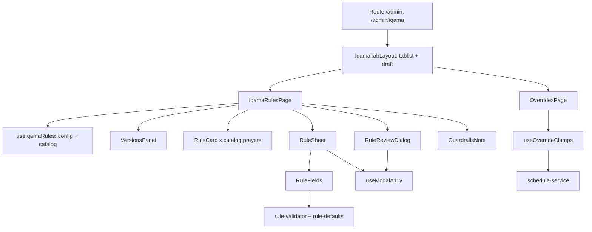

# Design Document — Iqama Rules Admin Tab

## Overview

`IqamaRulesPage` (`/admin/iqama`, the "Rules" view of the single "Iqama" nav tab; `/admin` is the "Overrides" view) is modelled on the Adhan tab: a card per prayer, a bottom sheet to edit, a draft reducer, a sticky unsaved bar, a review dialog, and a preview before every save. It talks to the engine's `/api/v1/admin/iqama-rules` API.

The engine is the source of truth. The exact shapes below mirror the engine's `.kiro/steering/iqama-rules-system.md`, section "UI contract (exact shapes)" (engine commit `c65aac2`). Test fixtures in `src/test/engine-*.fixture.ts` are verbatim snapshots of the engine's `RULE_CATALOG` and `DEFAULT_RULE_SET`; regenerate them when the contract changes.

## API contract (engine)

Auth for every call: header `x-api-key`. Dates `YYYY-MM-DD`, times `HH:mm`.

### `GET /`

```
{ mode: 'legacy'|'shadow'|'db', cutover, currentRevision, today, timezone, defaultEffectiveFrom,
  effective: V | null,   // in force today; null before the cutover or when nothing is saved
  latest:    V | null,   // NEWEST version = the baseline for every proposal
  upcoming:  V[],        // effectiveFrom > today, oldest first
  versions:  [{ id, effectiveFrom, createdAt, createdBy, reason, settings }] }
V = { versionId, effectiveFrom, createdAt, reason, rules: RuleSet|null, error: string|null }
```

`currentRevision === latest.versionId`. `createdBy` is always "admin" (shared password); the UI does not show it.

### `GET /catalog`

`{ prayers, baseTypes, modifiers, pipeline, guardrails }`

- `prayers[]`: `{ name, weeklyLockAllowed, fridayStartRequired, sunriseLimitAllowed }`
- `baseTypes[]`: `{ type, label, note?, fields: Field[] }`
- `modifiers[]`: `Field[]` for `limits`, `rounding`, `weekdayAdjust`, `weeklyLock`
- `guardrails`: `{ minGapAfterAzanMinutes, fajrEndsBeforeSunriseMinutes, iqamaStepMinutes, fajrSunriseConflictPolicy }`
- `Field`: `{ name, label, kind: 'int'|'time'|'enum'|'list'|'object'|'bool', required, prayers?, default?, note? }` plus `int`: `min, max, integer`; `time`: `format`; `enum`: `options[{ value, label }]`; `list`: `minItems, maxItems, item: Field[]`; `object`: `fields` or `discriminator` + `variants[{ value, label, fields }]`. `default` exists only where it is safe.

### `POST /preview`

Body `{ settings: string (JSON of the RuleSet), effectiveFrom }`. Response:

```
{ previewId, effectiveFrom, currentRevision, requestHash, warnings: [{path,message}],
  conflicts: [{ date, prayer, azan, sunrise, iqama, brokenLimit, wonBy }],   // up to 100
  days: [14 × { date, day_of_week, prayers: { <prayer>: { azan, current:{iqama,clamped}, proposed:{iqama,clamped} } } }],
  summary: { from, to, totalDays, daysChanged, daysClamped, daysClampedCurrent, conflictDays,
             firstChangedDates, firstClampedDates, byPrayer } }
```

`requestHash` is the SHA-256 of the canonical RuleSet and `effectiveFrom`. The token is valid for 10 minutes, once, for that hash and that revision.

### `PUT /base`

Body `{ settings, effectiveFrom, previewId, expectedRevision, reason?, acknowledgeConflicts?, requestHash? }`. The UI sends `reason` only when not empty (max 500), `acknowledgeConflicts: true` only when the Fajr checkbox is ticked, and always the preview's `requestHash`.

| Status | Meaning | UI |
|---|---|---|
| 400 `{ message, errors:[{path,message}] }` | invalid rules, past date, date before the newest version, non-Friday start for a changed Fajr/Dhuhr/Asr/Isha | message + field list in the dialog |
| 409 | `expectedRevision` is stale | stale notice, Save blocked, "Reload latest rules" |
| 422 `IQAMA_PREVIEW_INVALID` / `_MISMATCH` | token expired, used, or for other settings/date | drop the preview, show the message, scan again, confirmation needed again |
| 422 `IQAMA_REVISION_STALE` | preview made for another revision | same as 409 |
| 422 `IQAMA_CONFLICTS_NOT_ACKNOWLEDGED` | Fajr conflicts not acknowledged | same as the other 422s |

### Schedule and overrides

- `GET /api/v1/schedule`: `iqama_clamped` on a prayer entry when a guardrail moved it; `iqama_conflict` on the Fajr entry **and** on the day.
- `POST/PATCH /api/v1/admin/overrides[/:id]`: 409 `{ message }` when the dates overlap an active override for the same prayer.

## Baseline: always the newest version

A new version must be built from `latest.rules`, never from `effective`. The engine rejects an `effectiveFrom` earlier than the newest version, so a version cannot be inserted before a scheduled one; but a proposal built from `effective` would silently revert changes scheduled in an upcoming version. So:

- `proposed = { ...latest.rules, ...draft.prayers }` (the draft holds only the prayers the user changed).
- The date input's `min` is `max(today, latest.effectiveFrom)`; the default is `max(defaultEffectiveFrom, that)`.
- `VersionsPanel` shows "Editing on top of version N (effective …)", what is in force today, the scheduled (upcoming) versions in an amber box, and a short history (effective date, saved-at date, reason; no "who").
- If `latest` is null the page says nothing is saved; if `latest.rules` is null (stored invalid) editing is off.

## Preview binding

A confirmation is only valid for the preview it was given on.

- All inputs of a preview (RuleSet, `effectiveFrom`, loaded revision) form one `requestKey`. The preview is stored with the key it answered; the page only uses it while the key is current, so a change of rules or date removes it in the same render.
- A late answer for an older request is ignored (`cancelled` flag in the effect).
- The confirmation checkbox and the Fajr acknowledgement are stored as "given for `previewId` X"; a new preview has a new id, so both are unchecked again without any reset code.
- If `preview.currentRevision !== loaded currentRevision` (or a 409 / `IQAMA_REVISION_STALE`), Save is blocked and the dialog offers "Reload latest rules".
- **Reload keeps the draft.** It refetches `GET /`, closes the review (so the preview and both confirmations are gone), and re-applies the edited prayers on top of the new `latest` (`REBASE`). The draft remembers the saved rule each prayer was edited from (`bases`); if the new `latest` changed that prayer too, a notice names it ("… was changed by another save: your version is kept, review it") with "Use the saved version instead" (`DROP`). An edit equal to the new saved rule disappears. The chosen date is kept unless it is now earlier than the new latest's date; then it moves to the new default and the notice says so.
- On any 422 the preview is dropped and a new one is requested.

## Forms and validation come from the catalog

- `RuleFields` renders `int`, `time`, `enum`, `bool`, `list` and `object` (plain or with variants) recursively from catalog fields. Labels, ranges, options and list limits are the catalog's; nothing is parsed from strings.
- Values are plain data. A cleared required number or time is `''` (never `0`, never truncated); a cleared optional field removes its key (`setKey`). `5.5` is an error ("Enter a whole number"), not `5`.
- `rule-validator.ts` is one recursive validator over the catalog: required, integer, min/max, list `minItems`/`maxItems`, time `HH:mm`, enum options, variants, prayer-specific fields, and "an enabled optional group must have a value". Errors are keyed by path (`base.points.0.azan`) and shown next to the field with `aria-invalid`/`aria-describedby`.
- While the rule is invalid the sheet does not call `/preview` and "Add to changes" is disabled.
- `rule-defaults.ts` uses only catalog `default`s (weekly lock off, rounding step 5). Everything else starts empty and must be entered. Choosing a variant only makes its fields visible.
- shortcut: cross-field rules (strictly increasing Scaled-gap Azan times, unique Seasonal start dates, day-in-month) are left to the engine, which answers 400 with `errors[]`; they are shown in the sheet's preview area. Upgrade if the catalog starts describing them.
- What still needs UI code for a **new rule type**: the `RuleBase` union and `describeBase` (the plain-English sentence). The form itself comes from the catalog. The sentence for the existing types is hand-written.

## Dialog accessibility

`useModalA11y` (used by the rule sheet and the review dialog; both render in a portal under `<body>`): focus moves into the dialog on open and returns to the trigger on close, Tab/Shift+Tab are trapped, Escape closes (not while saving), and every other child of `<body>` gets `inert` while open. Touch targets are at least 44px; the Iqama segmented control is a `tablist` with roving tabindex and arrow keys.

## Copy

"Always applied" (`GuardrailsNote`) is built from the catalog: the hard minimum after Azan always holds (overrides included); the Fajr sunrise buffer is normally enforced, and when both cannot hold, the minimum wins, the day is flagged as a conflict and the admin must acknowledge it (shown when `fajrSunriseConflictPolicy` is `gap-wins-with-acknowledgement`); the 5-minute mark; Friday-start prayers; Maghrib any day. Times the guardrails move are called "adjusted". After a save the success text depends on `mode`: `db` "Saved and published", `shadow` "Saved … still comparing in the background", `legacy` "Saved … still uses the built-in rules".

The override form's 5-minute hint says the final time can be moved further to keep the safety rules and that the schedule and warning show the real time.

## Override warnings

`useOverrideClamps(overrides, today)` fetches the schedule range (first 31 days from `max(start, today)`) and marks an override when its prayer has `iqama_clamped` on any day. The cache key includes id, prayer, type, value and dates, so any edit recalculates; the previous answer is never shown for a new key. Overrides with the same range share one request. A failed request shows no warning. shortcut: it cannot tell an override clamp from a rule clamp (the schedule only says the prayer was adjusted).

## Components



## Testing

Vitest + msw + Testing Library. The shared server and fixtures are in `src/test/iqama-fixtures.ts` (shapes from the engine contract; catalog and seed rules are engine snapshots).

- `IqamaRulesPage.test.tsx`: baseline with a scheduled future version, date change after confirm, out-of-order previews, 422 / 409 / 400 handling, revision mismatch, Fajr conflicts and acknowledgement reset, reason, mode-specific success text, form validation (empty, decimal, range, Seasonal, Scaled gap, no invented defaults), guardrail copy, dialog focus/Escape/inert.
- `rule-validator.test.ts`: the validator accepts every rule of the engine seed and rejects the invalid cases above.
- `iqama-rules-service.test.ts`: request bodies, header, `ApiError.code`/`errors`.
- `useOverrideClamps.test.ts`: clamped, value change both ways, type change, dates change, delete, fetch failure, shared requests.
- `IqamaTabLayout.test.tsx`: routes, nav highlight, arrow keys, draft kept across views.

## Engine dependencies and known gaps

- The catalog label for `limits.latestBeforeSunrise` reads "At most this many minutes before sunrise"; the engine type comment says Iqama is at most (sunrise − N), i.e. at least N minutes before sunrise. The UI shows the catalog label in the form and "at least N min before sunrise" in the sentence. The engine should confirm the wording.
- No override-specific "would this be clamped" endpoint; the override warning is an approximation (see above).
- No server-side dry run for a single prayer's rule: the sheet previews the whole proposal.

## Review dialog layout (simplified)

Title, subtitle "<Prayers> · from <Fri, Nov 13>" and the date picker. For each CHANGED prayer only: the old → new sentence (`describeRule`), up to three example days where the time changes ("Fri 13  17:35 → 17:40", from `preview.days`), and one line ("Changes every day" / "Changes on N days" / "No time changes"). A warning "⚠ N days will be moved by safety rules" appears only for days moved because of this change: `summary.newlyMoved` (a number, or per prayer), else the fallback proposed − current (per prayer when `byPrayer[p].daysClampedCurrent` exists, else overall totals); zero shows nothing, so days that were already moved never warn. Totals, the per-prayer table, first dates and the "already today / new from this change" split are under a collapsed "Details" disclosure (`aria-expanded`). All safety logic (preview binding, resets, revision checks, Fajr acknowledgement, Friday rule, reason, 409/422) is unchanged. The user-facing word is "moved by safety rules"; "Adjusted" remains as the short strip badge, with that text as its tooltip.
