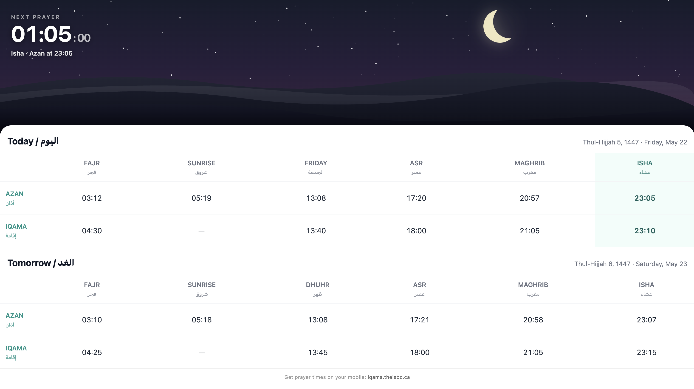

# Iqama UI

A React-based display app for the Iqama Engine. Shows live prayer times, countdown to the next prayer, and a dynamic sky scene that reflects the time of day.

## Screenshots

### Mobile App

<p float="left">
  
  
</p>

### Embeddable Widget



---

## Features

- Live countdown to the next Azan and Iqama
- Dynamic sky scene (dawn, day, dusk, night) driven by the current prayer
- Moon phase visualization based on the Hijri calendar date
- Today / Tomorrow prayer schedule table
- **Iqama Rules admin tab** (`/admin/iqama`): edit each prayer's iqama rule, preview the next 365 days, then save
- **URL-based simulator** for testing any date and time without touching the system clock

## Getting Started

### Prerequisites

- Node.js 18+
- A running [Iqama Engine](https://github.com/abudayah/iqama-engine) instance

### Setup

1. Install dependencies

```bash
npm install
```

2. Configure environment variables

```bash
cp .env.example .env
```

Edit `.env`:

```env
VITE_API_BASE_URL=http://localhost:3000
VITE_API_KEY=your-admin-api-key
```

3. Start the dev server

```bash
npm run dev
```

The app will be available at `http://localhost:5173`.

> **Local dev note:** `VITE_API_BASE_URL` must match the CSP origin exactly. The dev server only allows requests to that origin, and the browser remembers the API URL in localStorage. Use `http://localhost:3000`, not `http://127.0.0.1:3000`. A mismatch shows "Network request failed". The engine's `CORS_ORIGIN` must include `http://localhost:5173`.

### Build

```bash
npm run build
```

---

## Iqama Rules tab

`/admin/iqama` (tab "Iqama Rules"; the "Iqama" tab is the overrides page) manages the engine's iqama rules. It needs an engine with `IQAMA_RULES=db`; otherwise it shows a notice.

- **Cards:** one per prayer, with a plain-English sentence such as "Azan + 5 min, rounded up to the next 5".
- **Edit sheet:** tap a card to pick a rule type, fill its fields, and toggle modifiers. Forms are built from the engine catalog. A live 7-day strip shows Azan → Iqama, with an "Adjusted" badge on days a fixed rule moved later.
- **Review & save:** shows the effective date (default: next Friday) and a 365-day scan (days changed, days adjusted, first dates). Fajr, Dhuhr, Asr and Isha changes must start on a Friday; Maghrib can start any day.
- **Always applied:** a read-only numbered list at the bottom of the page: iqama at least 3 min after Azan, Fajr at least 60 min before sunrise, Friday starts, Maghrib any day. Values come from the catalog.
- **Overrides tab:** an override shows a warning when a fixed rule would move its time on some day in the next 31 days.

Spec: `.kiro/specs/iqama-rules-admin/`.

## Simulator

The simulator lets you preview any date and time without changing your system clock or touching the backend. It works by passing URL params that override what the app treats as "now".

### URL Params

| Param | Format | Description |
|---|---|---|
| `sim_date` | `YYYY-MM-DD` | Simulate a different date |
| `sim_time` | `HH:mm` | Simulate a specific time of day |

Both params are optional and independent — use one or both together.

### How It Works

- `sim_date` changes which date is fetched from the backend. The backend computes the correct prayer times **and Hijri date** for that day, so everything is accurate.
- `sim_time` shifts the clock used for "next prayer" and countdown logic. The countdown display freezes at that moment (it doesn't tick forward).
- When either param is active, a purple **Simulator** banner appears at the top of the page with an **Exit** button that removes the params.

### Examples

Simulate a winter day (early Asr, long Isha delay):
```
/?sim_date=2025-01-15
```

Simulate pre-Fajr time (DAWN sky, Fajr countdown):
```
/?sim_time=04:30
```

Simulate Maghrib window (DUSK sky):
```
/?sim_time=19:45
```

Simulate a specific date and time together:
```
/?sim_date=2025-06-15&sim_time=20:00
```

Simulate a Friday in Ramadan:
```
/?sim_date=2025-03-07&sim_time=03:45
```

### What Gets Simulated

| Thing | Simulated? | Notes |
|---|---|---|
| Prayer times | ✅ | Backend fetches real times for `sim_date` |
| Hijri date & moon phase | ✅ | Derived from `sim_date` by the backend |
| Day of week | ✅ | Comes from the backend response |
| Sky phase (dawn/day/dusk/night) | ✅ | Driven by which prayer is next at `sim_time` |
| Countdown display | ✅ | Frozen at `sim_time` |
| System clock | ❌ | Never touched |

### Implementation

The simulator is implemented entirely in the frontend:

- `src/hooks/useSimulator.ts` — reads and validates the URL params, returns a `simNow` Date and the effective date strings
- `src/hooks/usePrayerContext.ts` — accepts an optional `simulatedNow` param; when provided, all time comparisons use it instead of `new Date()`
- `src/pages/PrayerViewerPage.tsx` — passes `simDateStr` / `simTomorrowStr` to `useSchedule` and `simNow` to `usePrayerContext`
- `src/components/SimulatorBanner.tsx` — the purple banner shown when simulation is active

---

## Project Structure

```
iqama-ui/
├── src/
│   ├── api/                # API client and error types
│   ├── components/         # UI components
│   │   ├── HeroBanner.tsx      # Sky scene, countdown, moon phase
│   │   ├── PrayerTable.tsx     # Today/tomorrow schedule table
│   │   ├── SimulatorBanner.tsx # Simulator mode indicator
│   │   └── ...
│   ├── hooks/              # React hooks
│   │   ├── usePrayerContext.ts # Core time/prayer state
│   │   ├── useSchedule.ts      # Schedule data fetching
│   │   ├── useSimulator.ts     # URL param simulator
│   │   └── ...
│   ├── logic/              # Pure functions (no React)
│   │   ├── derive-next-prayer.ts
│   │   └── derive-countdown.ts
│   ├── pages/
│   │   ├── PrayerViewerPage.tsx
│   │   └── AdminPage.tsx
│   ├── services/           # API service functions
│   ├── store/              # Config store
│   └── types/              # Shared TypeScript types
└── ...
```

## License

MIT

---

Built with [React](https://react.dev/) + [Vite](https://vitejs.dev/) • Powered by [iqama-engine](https://github.com/abudayah/iqama-engine)
